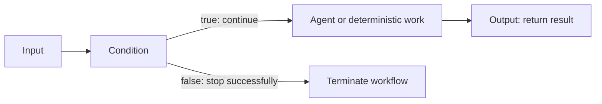

# Explicit workflow termination

Schema 1.18 adds the `core.terminate` node for a successful exit that returns no workflow value. The existing Output node remains the ordinary result path. A graph may now route different condition arms to Output or to one of up to 16 termination exits; a merge is needed only when paths must share downstream work.

## Author a termination exit

Select the connection leaving the route to stop, then choose **Terminate workflow** from the node library. The node replaces that connection and has no outgoing pin. For example, insert it on a condition's false output to end that route while the true route continues to the workflow Output. The insertion disconnects the route's former destination; if that leaves processing nodes unreachable, the draft reports those validation issues and must be repaired before it can run or publish.

Termination accepts string paths. It is a successful control-flow outcome, not a node failure or cancellation. It does not undo MCP calls or other work that already happened on the route. The Studio viewer labels the run **terminated** and explains that no result was returned. Playback uses recorded events and does not re-execute the graph.

## Runtime and audit contract

The graph still declares one workflow Output for ordinary returns. The Agent Framework adapter uses that executor as the workflow's output sink; a termination node's message is internally forwarded to the sink with a typed-in-memory termination marker. No synthetic graph connection is serialized. The sink records that the route ended without a result, and the run store appends a payload-free `run.terminated` terminal event. No event can follow it. `RunSnapshot.Status` is `terminated`, and the snapshot is terminal for recovery and run control.

`PipelineRunner.ExecuteWithOutcomeAsync` and its controlled counterpart return `WorkflowExecutionResult`, where termination has `Output == null` and `Terminated == true`. Existing string-returning runner methods remain source-compatible and map this case to `string.Empty`; integrations that must distinguish an empty output from no output should use the outcome API or observe the run's terminal status.

The node is schema 1.18, accepts string input, has no serialized output pin, and is bounded to 16 exits in a graph of at most 256 nodes. The declared Output may have no incoming graph edge when at least one termination exit exists. Other unreachable graph nodes remain invalid. Termination is excluded from the current checkpoint-resume subset; ordinary run auditing and playback support it.
