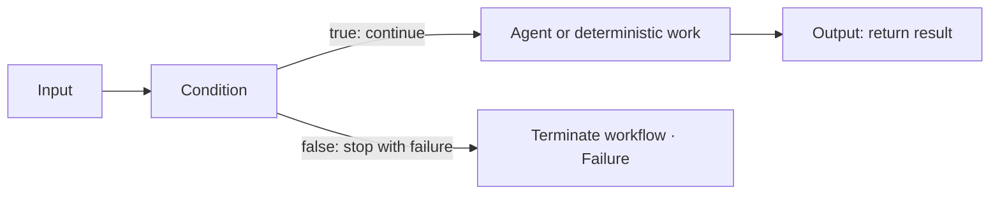

# Explicit workflow termination

Schema 1.20 lets each `core.terminate` node declare a **Success** or **Failure** outcome. The existing Output node remains the ordinary result path. A graph may route condition arms to Output or to up to 16 termination exits, including multiple exits with different outcomes; a merge is needed only when paths must share downstream work. Earlier termination nodes without an outcome remain successful exits.

## Author a termination exit

Add **Terminate workflow** from the node library to create an unconnected node. Connect the route you want to end to its input, then choose **Success** or **Failure** in its properties. You can create multiple exits to handle different branches independently. New nodes are not wired implicitly. Incomplete topology can be saved as a draft, with validation issues visible; it cannot be published or run until repaired.

Termination accepts string paths. **Success** ends the selected route without returning a value and marks the run `terminated`. **Failure** ends the route and marks the run failed, with no output. Neither outcome undoes MCP calls or other work already performed. The viewer and audit trail record which termination node ended the route; playback makes no calls.

## Runtime and audit contract

The graph still declares one workflow Output for ordinary returns. The Agent Framework adapter uses that executor as the workflow's output sink; a termination node's message is internally forwarded to the sink with a typed-in-memory termination marker. No synthetic graph connection is serialized. The sink records that the route ended without a result. Success appends `run.terminated` and sets `RunSnapshot.Status` to `terminated`; failure appends `run.failed` and sets status to `failed`. Both are terminal events, so no event can follow either one.

`PipelineRunner.ExecuteWithOutcomeAsync` and its controlled counterpart return `WorkflowExecutionResult`, where either termination has `Output == null` and `Terminated == true`; a failure exit additionally sets `Failed == true`. The run journal records a failed terminal event for the latter. Existing string-returning runner methods remain source-compatible and map either no-result outcome to `string.Empty`; integrations that must distinguish an empty output from no output or inspect failure should use the outcome API or observe the run's terminal status.

The node was introduced in schema 1.18 and accepts string input with no output pin. Its optional outcome is available in schema 1.20; it is bounded to 16 exits in a graph of at most 256 nodes. The declared Output may have no incoming graph edge when at least one termination exit exists. Other unreachable graph nodes remain invalid. Termination is excluded from the current checkpoint-resume subset; ordinary run auditing and playback support both outcomes.
